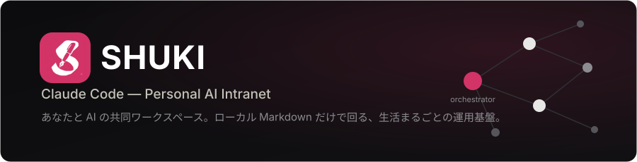
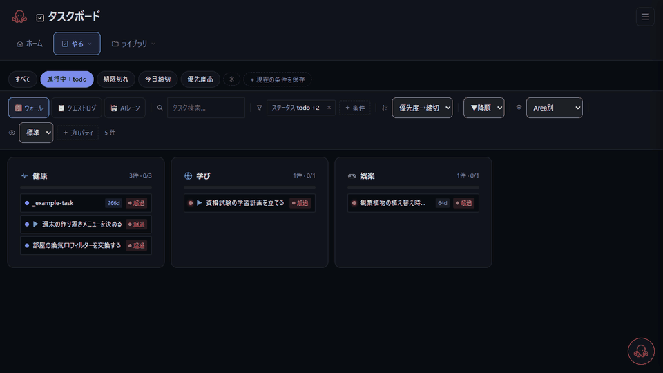
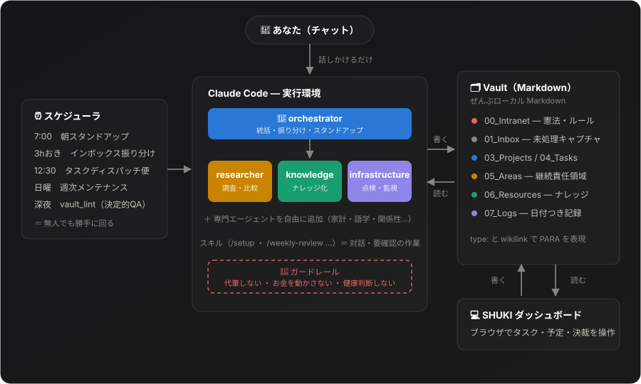

<div align="center">



[](LICENSE)
[](https://obsidian.md/)
[](https://claude.com/claude-code)

[English](README.en.md)

</div>

SHUKI は、Obsidian のノートと AI による整理作業をつなぐ個人用のシステムです。メモやタスクを Markdown で保存し、Claude Code で追加・検索・整理します。ブラウザのダッシュボードでは、タスク、予定、ニュース、承認待ちの依頼を確認できます。



<sub>同梱のサンプルデータを使って撮影したダッシュボード。約15秒。</sub>

## このリポジトリに含まれるもの

- Obsidian vault のフォルダ構成、ノートのテンプレート、サンプルデータ
- Claude Code のエージェント定義と、セットアップ・調査・週次レビューなどのワークフロー
- AIチャット、タスクボード、カレンダー、ニュース、決裁カードを備えたローカルダッシュボード
- フィード取得、ノートの構造チェック、定期実行用のスクリプト

個人のノートやログ、認証情報は含めていません。作者が使っている家計、英語練習、ゲーム、可視化などの追加プラグインも公開対象外です。

## 使い始める

[Claude Code](https://claude.com/claude-code) と [Obsidian](https://obsidian.md/) をインストールしてから、リポジトリを取得します。Git を使わず ZIP でダウンロードすることもできます。

```sh
git clone https://github.com/sflren6741/SHUKI my-vault
cd my-vault
claude
```

Claude Code で `/setup` を実行すると、自分のプロフィール、責任領域、パス設定などを対話で設定できます。Obsidian では `my-vault` を vault として開いてください。プラグインの有効化など、アプリ上で行う設定もあります。

インストールと設定の詳細は [セットアップガイド](docs/SETUP.md) にあります。論文の新着追跡とタスク管理に絞る場合は、[研究向けクイックスタート](docs/QUICKSTART-RESEARCH.md) を参照してください。

### ダッシュボードを使う

Python 3.11 以降が必要です。`SHUKI_VAULT` に vault の絶対パスを設定し、リポジトリのルートで起動します。PowerShell の例：

```powershell
$env:SHUKI_VAULT = (Get-Location).Path
python scripts/dashboard_server.py
```

ブラウザで <http://127.0.0.1:8765/> を開きます。コア機能は Python の標準ライブラリで動作します。AIチャットには選択した CLI の設定が、Google カレンダー連携には追加パッケージとアカウント接続が必要です。詳細は [scripts/README.md](scripts/README.md) にあります。

ダッシュボードや定期実行は任意です。Obsidian と Claude Code だけで始め、必要になった機能を追加できます。定期実行を使う場合は [自動化ガイド](docs/AUTOMATION.md) を参照してください。

## 日常の使い方

Claude Code に、保存・整理したい内容を伝えます。

```text
メモ追加：『Thinking, Fast and Slow』を読みたい
今週の進行中タスクを見せて
このURLをナレッジノートにして: https://...
```



<sub>チャットでの操作例を描いた SVG。</sub>

保存されたノートは Obsidian で読んだり、直接編集したりできます。関連するノートは wikilink でつなぎ、タスクの状態や期限はプロパティで管理します。`/next` は次に取り組むタスクの選定、`/weekly-review` は対話での週次レビューに使います。

| ダッシュボードのページ | 用途 |
|---|---|
| ホーム・タスク（`/`・`/board`） | タスクの状態、期限、担当を確認する |
| カレンダー（`/calendar`） | 予定とタスクを日付で見る |
| ニュース（`/news`） | 購読フィードから選定された記事を読む |
| 決裁（`/decisions`） | AIからの確認依頼に回答する |

## 仕組み



<sub>チャット、エージェント、ノートの関係。図中の定期実行は別途設定が必要です。</sub>

エージェントの役割は `.claude/agents/`、対話ワークフローの手順は `.claude/skills/` にあります。共通ルールは `00_Intranet/` に置きます。これらを編集して、自分の用途に合わせて調整できます。

| エージェント | 担当 |
|---|---|
| `orchestrator` | インボックスの振り分け、タスクの引き渡し、レビュー |
| `researcher` | 調査と比較。予約・購入は行わない |
| `knowledge` | 外部コンテンツのノート化と、関連ノートへのリンク追加 |
| `infrastructure` | タスクDBの点検、重複や運用上の問題の検出。変更は提案まで |

エージェントの追加方法は [エージェントガイド](docs/AGENTS.md) にあります。

<details>
<summary>フォルダ構成</summary>

```text
my-vault/
├── 00_Intranet/     共通ルール
├── 01_Inbox/        未整理のメモ
├── 02_Home/         ホーム
├── 03_Projects/     期限のあるプロジェクト
├── 04_Tasks/        1ファイルにつき1タスク
├── 05_Areas/        継続して管理する領域
├── 06_Resources/    ナレッジと概念ノート
├── 07_Logs/         日付のある記録
├── _Templates/     ノートのテンプレート
├── .claude/        エージェントとワークフローの定義
└── scripts/        ダッシュボードと運用スクリプト
```

各フォルダの README と `_example-*.md` は、保存先やプロパティの使い方を示すサンプルです。

</details>

## 作った理由と運用上の境界

仕事のタスク、読んだもの、考えたことを一つの場所に残し、整理を AI に手伝わせたくて作りました。記録がファイルとして残るので、会話が終わったあとも検索・編集できます。

ノートは手元に保存します。クラウドの AI を使う場合、プロンプトに含めた内容はそのサービスへ送られます。

支払い、健康に関する判断、外部への送信には人間の確認を入れます。エージェントごとに担当範囲とツール権限を定義しています。個人用に作ったシステムなので、導入時にルールと設定を確認してください。

<a id="english-ui"></a>

## 表示言語

ダッシュボードの「設定 → 表示言語」で English を選べます。訳がないラベルは日本語のまま表示されます。ノートの本文は翻訳されません。

英語の説明は [README.en.md](README.en.md) と [docs/en/](docs/en/) にあります。ルールやエージェント定義には日本語が残っています。フォルダ名を参照するスクリプトがあるため、名前を変える場合は参照先も確認してください。

## 詳細ガイド

| ガイド | 内容 |
|---|---|
| [セットアップ](docs/SETUP.md) | インストールと初期設定 |
| [研究向けクイックスタート](docs/QUICKSTART-RESEARCH.md) | 論文の新着追跡とタスク管理 |
| [Obsidian の設定](docs/OBSIDIAN-SETUP.md) | プラグイン、プロパティ、リンク |
| [エージェント](docs/AGENTS.md) | 役割の定義と追加方法 |
| [モバイル同期](docs/MOBILE-SYNC.md) | Android と FolderSync での同期 |
| [自動化](docs/AUTOMATION.md) | 定期実行の設定 |
| [設計の考え方](docs/TIPS.md) | PARA、wikilink、概念ノート、担当範囲 |

## 問い合わせとライセンス

質問や不具合は [GitHub Issues](https://github.com/sflren6741/SHUKI/issues) へ。

[MIT License](LICENSE)。
